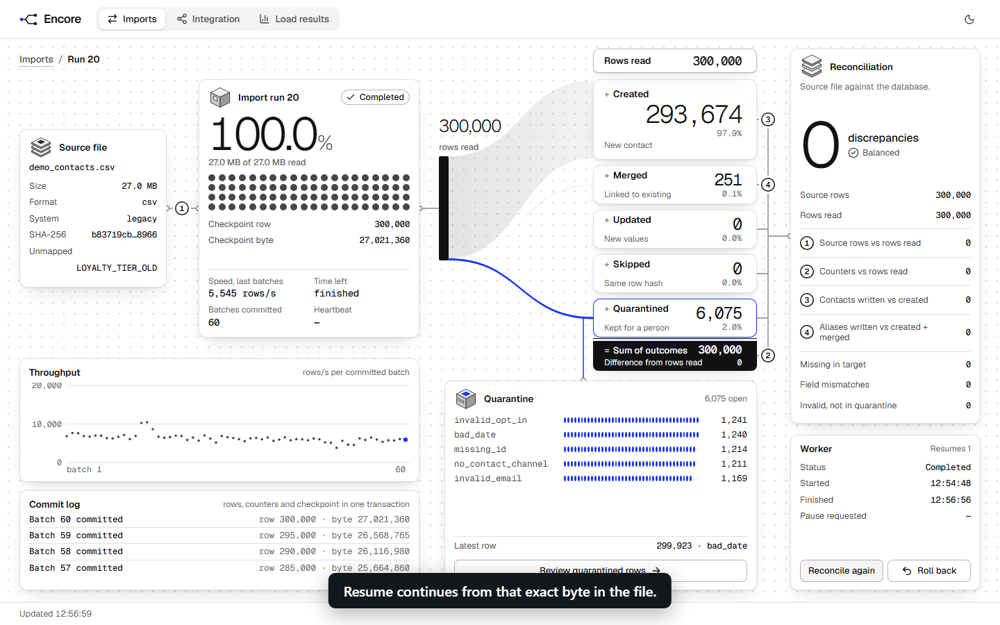
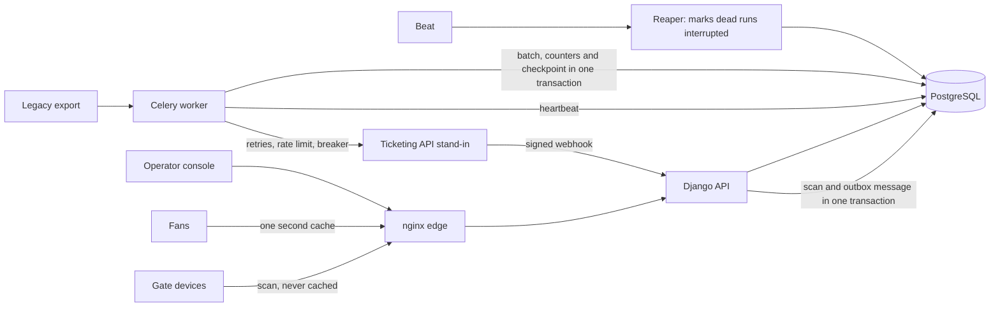

# Encore

A working demo of two jobs that come up when a live-events platform modernises: moving customers from a legacy CRM, and staying reliable against an external ticketing API.

Built with Django, PostgreSQL, Celery and Redis. An operator console shows every run as it happens.

**Status:** demo on synthetic data, not production software. It has never handled real customers or real traffic. No real company's data, name or code is used.

**How it was built:** AI wrote most of the code, under my direction. I set the requirements and the design, made the decisions in [docs/decisions.md](docs/decisions.md), and checked the results through the tests and measurements below.



A recording of the whole scenario is in [docs/demo.webm](docs/demo.webm).

## What it proves

| Situation | What happens |
|---|---|
| The worker is killed in the middle of an import | The run resumes from its last committed batch. Nothing is lost or duplicated |
| The same file is imported twice | The second run creates nothing |
| Rows are broken | Each goes to quarantine with its reason. An operator can correct and retry it, or dismiss it |
| The import has finished | The file is read again and compared with the database |
| A run was a mistake | The latest run can be rolled back to the exact earlier state |
| The API returns 429, 5xx or times out | Retries with backoff and jitter, honouring `Retry-After` given in seconds, inside a time budget |
| The API goes down | The circuit breaker stops the traffic, then probes and recovers by itself |
| Events arrive twice or out of order | Duplicates are ignored, and an older version never overwrites a newer one |
| Twelve gates scan one ticket at once | Exactly one is admitted |
| Thousands of fans refresh one page | The edge answers from a one second cache, and Django sees almost none of it |
| Django stops during a spike | Fans keep seeing the last known page, with no errors |
| Clients open connections and send nothing | Real requests are still answered at once |
| A flood hits Django directly | It answers again as soon as the flood ends |

## Measured

One run on a laptop, under Docker Desktop (8 CPUs and 7 GB in the VM), on synthetic data, on 6 November 2026.

**Import, including hashing and full reconciliation**

| Rows | File | Time | Rows per second | Worker memory, highest sample | Quarantined | Discrepancies |
|---:|---:|---:|---:|---:|---:|---:|
| 1,000,000 | 86 MB | 4 min 29 s | 3,724 | 168 MB | 19,761 | 0 |
| 10,000,000 | 871 MB | 41 min 6 s | 4,055 | 192 MB | 199,602 | 0 |

The generator breaks about 2% of the rows on purpose, and those are the quarantined ones. Ten times the data needed about the same memory, because the file is streamed. Memory was sampled every 3 seconds.

**Fans refreshing one event page, each about every 2 seconds, for 60 seconds at the peak, asking for compressed replies as browsers do**

| Fans at once | Path | Requests per second | Failed | p95 | p99 | From cache |
|---:|---|---:|---:|---:|---:|---:|
| 5,000 | Django directly | 1,598 | 0% | 1,289 ms | 1,526 ms | 0.0% |
| 5,000 | Through the edge | 2,099 | 0% | 0.7 ms | 1 ms | 100.0% |
| 10,000 | Through the edge | 4,186 | 0% | 0.9 ms | 2.9 ms | 100.0% |
| 20,000 | Through the edge | 8,132 | 0% | 134 ms | 352 ms | 100.0% |

The edge is nginx with a one second cache. The numbers fans see can be about a second old, and in exchange almost none of them reach Python.

**Gates scanning tickets while 10,000 fans refresh**

| Scans requested per second | Tickets admitted per second | Scans failed | Gate p50 | Gate p95 | Gate p99 |
|---:|---:|---:|---:|---:|---:|
| 300 | 300 | 0% | 8.3 ms | 22 ms | 88 ms |
| 600 | 600 | 0.004% | 19 ms | 143 ms | 356 ms |
| 1,000 | 816 | 0.015% | 1,180 ms | 1,535 ms | 1,715 ms |
| 1,500 | 781 | 0.006% | 1,234 ms | 1,629 ms | 1,899 ms |

Scans saturate at about 781 to 816 per second on this machine: above that they queue. Admitted tickets and outbox messages matched in every run. Scans cannot be cached, so this is the real write limit of this setup. The few failed scans were not investigated.

**Django stopped in the middle of a spike, with 5,000 fans refreshing:** 0 failed requests, because the edge keeps serving the last known page. A page nobody has requested yet has no copy to serve, so it fails until Django returns. Gate scans need Django, so they would stop until it returns. That combination was not measured.

These numbers come from one run per scenario. The load generator shares the machine with the system, which competes for CPU. They show behaviour on a laptop, not production capacity. A real deployment would need a CDN, more than one machine and its own measurements. Your numbers will differ.


**The same tests on a machine two levels smaller:** 2 shared CPU cores, 2 GB of memory in total, 1 Gunicorn worker and 1 Celery worker (`docker-compose.low.yml`). The load generator ran on other cores.

| Fans at once | Path | Requests per second | Failed | p95 | p99 | From cache |
|---:|---|---:|---:|---:|---:|---:|
| 5,000 | Django directly | 621 | 20.888% | 7,820 ms | 8,989 ms | 0.0% |
| 5,000 | Through the edge | 2,095 | 0% | 0.9 ms | 1.6 ms | 100.0% |
| 10,000 | Through the edge | 4,185 | 0% | 1.4 ms | 4.5 ms | 100.0% |
| 20,000 | Through the edge | 8,193 | 0% | 158 ms | 287 ms | 100.0% |

| Scans requested per second | Tickets admitted per second | Scans failed | Gate p50 | Gate p95 | Gate p99 |
|---:|---:|---:|---:|---:|---:|
| 75 | 75 | 0.017% | 8.7 ms | 24 ms | 61 ms |
| 150 | 150 | 0% | 9.3 ms | 31 ms | 102 ms |
| 300 | 300 | 0.021% | 867 ms | 1,283 ms | 1,339 ms |
| 600 | 246 | 0.025% | 4,241 ms | 5,409 ms | 6,453 ms |

Fans are fine on this machine, as long as they come through the edge. Scans are fast up to about 150 per second, and past about 300 per second they saturate. Importing 1,000,000 rows took 3.7 minutes at 4,505 rows per second with 142 MB of worker memory and 0 discrepancies. It works in one sequential worker, so fewer cores did not slow it in this run. Disk and network were not limited, so a slow disk would change this. The 10,000,000 row import was not repeated here.

Results are in `docs/benchmarks-low.json`. Reproduce them with `export COMPOSE_PATH_SEPARATOR=: COMPOSE_FILE=docker-compose.yml:docker-compose.low.yml`, then `bash scripts/run_benchmarks.sh --stack-only bash scripts/low_tier_runs.sh`.

Reproduce the import numbers with `bash scripts/run_benchmarks.sh`, and a spike with `bash scripts/run_benchmarks.sh --stack-only python scripts/spike_bench.py "My test" edge 10000`. Both use the virtual environment from [Tests](#tests) and wipe demo tables in the local stack.

## Run it

Needs Docker with Compose.

```bash
export ENCORE_DEBUG=1
```

```bash
docker compose up -d --build
```

In PowerShell, the first line is `$env:ENCORE_DEBUG=1`. Then open <http://localhost:8000>.

Debug mode is for your own machine only. Without it, the app needs real secrets and refuses to start without them. On Linux, the container runs as uid 1000, so `data/` must be writable by that user.

Generate a file for the console's start form:

```bash
docker compose exec worker python manage.py gen_legacy --rows 300000 --out data/demo_contacts.csv
```

## The five minute demo

1. Start an import from the console.
2. Kill the worker partway through:
   ```bash
   docker compose kill -s SIGKILL worker
   ```
3. Restart it, then watch the heartbeat go stale and the run turn to interrupted:
   ```bash
   docker compose up -d worker
   ```
4. Press Resume. When it finishes, the reconciliation panel shows the result.
5. Open Integration and switch on failures. Watch the connector retry, then switch on the outage and watch the breaker open and recover.
6. Open Load results.

`python scripts/demo_scenario.py` runs steps 1 to 5 from the command line and stops with an error if a guarantee does not hold. It wipes the ticketing tables in the local stack.


## How it works



- `imports/`: streaming reader, validation, batch pipeline, reconciliation, rollback
- `ticketing/`: reliability primitives, API client, cursor sync, webhooks, gate scans, outbox
- `crm/`: contacts and legacy record aliases
- `console/`: the operator screens
- `mock_api/`: the stand-in ticketing API, with failures you can switch on
- `deploy/nginx.conf`: the edge cache
- `deploy/gunicorn.conf.py`: the worker thread fix described in the decisions
- `scripts/`: demo scenario and measurements (k6 for spikes)

The reasoning behind each choice, and what it costs, is in [docs/decisions.md](docs/decisions.md). That file also lists the known limits of this version.

## Settings outside debug mode

| Variable | Purpose |
|---|---|
| `ENCORE_SECRET_KEY` | Required |
| `ENCORE_OPERATOR_TOKEN` | Required for any write. With no token, writes are refused |
| `TICKETING_WEBHOOK_SECRET` | Required for webhooks. With no secret, every webhook is refused |
| `ENCORE_ALLOWED_HOSTS` | Your domain, comma separated |
| `ENCORE_HTTPS` | `1` behind a TLS proxy that sets `X-Forwarded-Proto` |
| `POSTGRES_PASSWORD` | Database password |

Reads are public even with a token, including quarantined rows. This version is for synthetic data only: do not load real customer data into it. Do not expose ports 8001, 8099, 5433 or 6380: the stand-in API has no authentication of its own.

## Tests

```bash
python -m venv .venv
.venv/bin/pip install -r requirements-dev.lock
docker compose up -d db redis
ENCORE_DEBUG=1 .venv/bin/pytest
```

The tests run against real PostgreSQL. They include killing a real importer process mid-run, and pushing the connector through injected failures against a real HTTP server.

## What it does not cover

- Operation in production, or at scale beyond one machine
- Infrastructure beyond Docker Compose
- User accounts and read protection: only writes are protected, by one operator token
- Real personal data: there is no access control or retention policy for it
- Load beyond the measurements above
