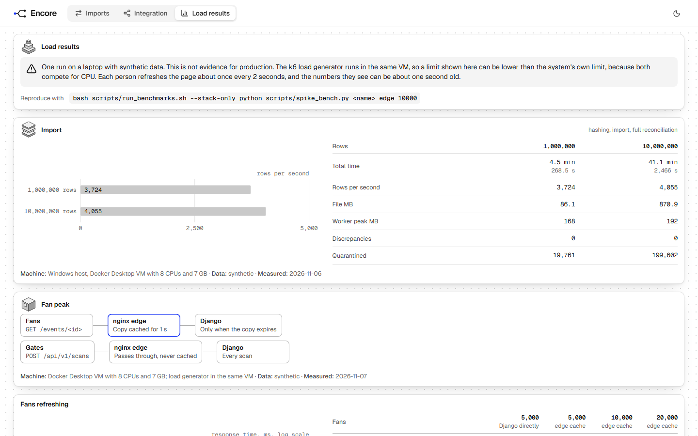
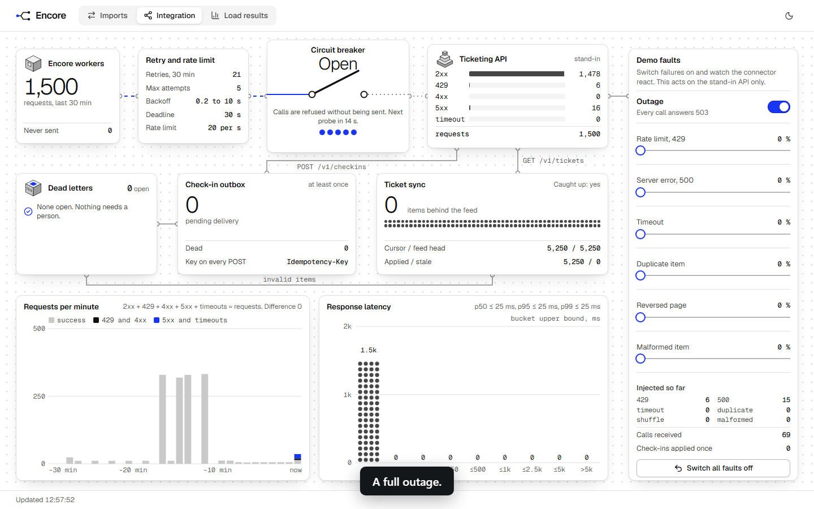
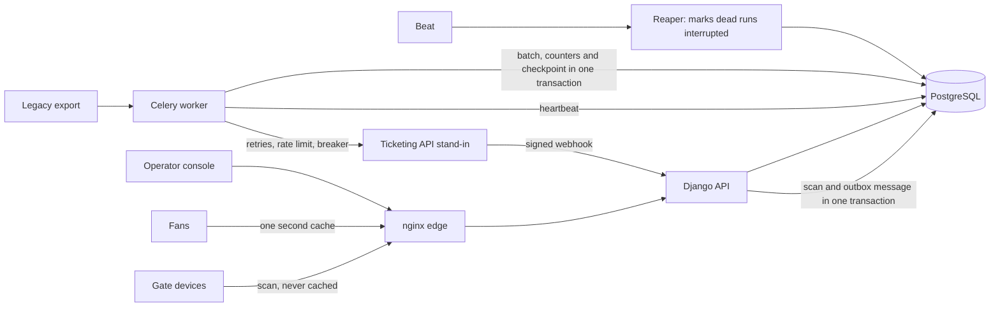

# Encore

A working demo of two jobs that come up when a live-events platform modernises: moving customers from a legacy CRM, and staying reliable against an external ticketing API.

Built with Django, PostgreSQL, Celery and Redis. An operator console shows every run as it happens.

**Status:** demo on synthetic data, not production software. It has never handled real customers or real traffic. No real company's data, name or code is used.

**How it was built:** AI wrote most of the code, under my direction. I set the requirements and the design, made the decisions in [docs/decisions.md](docs/decisions.md), and checked the results through the tests and measurements below.


A recording of the whole scenario (`demo.webm`) and `Encore-Pack.html`, one file with the program, the code and all the material that opens with no server, are attached to the [latest release](../../releases/latest). They are kept out of git to keep the clone small; `python scripts/record_demo.py` and `python scripts/build_pack.py` rebuild them.

## What it proves

| Situation | What happens |
|---|---|
| The worker is killed in the middle of an import | The run resumes from its last committed batch. Nothing is lost or duplicated |
| The same file is imported twice | The second run creates nothing |
| Rows are broken | Each goes to quarantine with its reason. An operator can correct and retry it, or dismiss it |
| The import has finished | The file is read again and compared with the database |
| A run was a mistake | The latest run that wrote rows can be rolled back to the earlier state, also after it failed or paused. A later run that wrote anything blocks it |
| The API returns 429, 5xx or times out | Retries with backoff and jitter, honouring `Retry-After` given in seconds, inside a time budget |
| The API goes down | The circuit breaker stops the traffic, then probes and recovers by itself |
| Events arrive twice or out of order | Duplicates are ignored, and an older version never overwrites a newer one |
| Twelve gates scan one ticket at once | Exactly one is admitted |
| Thousands of fans refresh one page | The edge answers from a one second cache, and Django sees almost none of it |
| Django stops during a spike | Fans keep seeing the last known page, with no errors |
| Clients open connections and send nothing | Real requests are still answered at once |
| A flood hits Django directly | It answers again as soon as the flood ends |
| Two organizers have the same customer | Two separate contacts. Each organizer's import is isolated, and they can run side by side |
| A person asks to be erased during a migration | They are removed from contacts, broken rows, rollback snapshots and that organizer's tickets, stay out of later runs, and are removed again after a restore once the ledger copy is replayed |
| A card number was pasted into a legacy notes field | The row is quarantined with no content kept, also when the row is broken for another reason |
| Gates lose the network | A gate decides from a downloaded list, and uploads later. Double entries become conflicts for review |
| A worker pod is killed on Kubernetes | The run resumes by itself from its checkpoint |

## Measured

One run on a laptop, under Docker Desktop (8 CPUs and 7 GB in the VM), on synthetic data, on 2026-11-07.

**Import, including hashing and full reconciliation**

| Rows | File | Time | Rows per second | Worker memory, highest sample | Quarantined | Discrepancies |
|---:|---:|---:|---:|---:|---:|---:|
| 1,000,000 | 86 MB | 4.5 min | 3,698 | 152 MB | 19,761 | 0 |
| 10,000,000 | 871 MB | 40.6 min | 4,108 | 167 MB | 199,602 | 0 |

The generator breaks about 2% of the rows on purpose, and those are the quarantined ones. Ten times the data needed about the same memory, because the file is streamed. Memory was sampled every 3 seconds.

**Organizers side by side**

| Organizers at once | Rows each | Rows per second, all together | Discrepancies | Cross-organizer merges |
|---:|---:|---:|---:|---:|
| 1 | 250,000 | 3,496 | 0 | 0 |
| 2 | 250,000 | 6,868 | 0 | 0 |
| 4 | 250,000 | 9,549 | 0 | 0 |

Results are in `docs/benchmarks-parallel.json`.

**Fans refreshing one event page, each about every 2 seconds, for 60 seconds at the peak, asking for compressed replies as browsers do**

| Fans at once | Path | Requests per second | Failed | p95 | p99 | From cache |
|---:|---|---:|---:|---:|---:|---:|
| 5,000 | Django directly | 1,430 | 0% | 2,481 ms | 3,557 ms | 0.0% |
| 5,000 | Through the edge | 2,094 | 0% | 0.8 ms | 1.7 ms | 100.0% |
| 10,000 | Through the edge | 4,196 | 0% | 0.8 ms | 2.1 ms | 100.0% |
| 20,000 | Through the edge | 8,147 | 0% | 143 ms | 235 ms | 100.0% |

The edge is nginx with a one second cache. The numbers fans see can be about a second old, and in exchange almost none of them reach Python.

**Gates scanning tickets while 10,000 fans refresh**

| Scans requested per second | Tickets admitted per second | Scans failed | Gate p50 | Gate p95 | Gate p99 |
|---:|---:|---:|---:|---:|---:|
| 300 | 300 | 0% | 7.4 ms | 18 ms | 58 ms |
| 600 | 568 | 0.02% | 39 ms | 1,402 ms | 1,708 ms |
| 1,000 | 755 | 0.012% | 1,160 ms | 1,865 ms | 2,321 ms |
| 1,500 | 773 | 0.002% | 1,200 ms | 1,979 ms | 2,267 ms |

Scans saturate at about 755 to 773 per second on this machine: above that they queue. Admitted tickets and outbox messages matched in every run. Scans cannot be cached, so this is the real write limit of this setup. The few failed scans came from keep-alive: Gunicorn closed idle connections after 2 s while nginx reused them for up to 60 s, and nginx does not retry a POST. That is fixed and covered by a test against a real Gunicorn ([incident review](docs/incident-gunicorn.md)); the throughput numbers above are from before the fix.

**Django stopped in the middle of a spike, with 5,000 fans refreshing:** 0 failed requests, because the edge keeps serving the last known page. A page nobody has requested yet has no copy to serve, so it fails until Django returns. Gate scans need Django, so they would stop until it returns. That combination was not measured.

These numbers come from one run per scenario. A first attempt ran while another program was rendering video on the same laptop. Those results were discarded and the runs repeated, with the host's load logged every 30 seconds. The load generator shares the machine with the system, which competes for CPU. They show behaviour on a laptop, not production capacity. A real deployment would need a CDN, more than one machine and its own measurements. Your numbers will differ.



**The same tests on a machine two levels smaller:** 2 shared CPU cores, 2 GB of memory in total, 1 Gunicorn worker and 1 Celery worker (`docker-compose.low.yml`). The load generator ran on other cores.

| Fans at once | Path | Requests per second | Failed | p95 | p99 | From cache |
|---:|---|---:|---:|---:|---:|---:|
| 5,000 | Django directly | 666 | 17.326% | 6,949 ms | 8,986 ms | 0.0% |
| 5,000 | Through the edge | 2,093 | 0% | 0.8 ms | 1.5 ms | 100.0% |
| 10,000 | Through the edge | 4,160 | 0% | 72 ms | 168 ms | 100.0% |
| 20,000 | Through the edge | 7,926 | 0% | 422 ms | 778 ms | 100.0% |

| Scans requested per second | Tickets admitted per second | Scans failed | Gate p50 | Gate p95 | Gate p99 |
|---:|---:|---:|---:|---:|---:|
| 75 | 75 | 0.017% | 7.5 ms | 20 ms | 64 ms |
| 150 | 147 | 1.115% | 13 ms | 2,045 ms | 3,487 ms |
| 300 | 288 | 0.03% | 1,842 ms | 3,729 ms | 3,831 ms |
| 600 | 295 | 0.064% | 3,523 ms | 3,849 ms | 4,056 ms |

Fans are fine on this machine, as long as they come through the edge. Scans are fast at 75 per second. At 150 per second most are still fast, but the slowest take about two seconds and about 1% fail. They saturate at about 290 per second. Importing 1,000,000 rows took 4.2 minutes at 3,947 rows per second with 140 MB of worker memory and 0 discrepancies. It works in one sequential worker, so fewer cores did not slow it in this run. Disk and network were not limited, so a slow disk would change this. The 10,000,000 row import was not repeated here.

Results are in `docs/benchmarks-low.json`. Reproduce them with `export COMPOSE_PATH_SEPARATOR=: COMPOSE_FILE=docker-compose.yml:docker-compose.low.yml`, then `bash scripts/run_benchmarks.sh --stack-only bash scripts/low_tier_runs.sh`.

Reproduce the import numbers with `bash scripts/run_benchmarks.sh`, and a spike with `bash scripts/run_benchmarks.sh --stack-only python scripts/spike_bench.py "My test" edge 10000`. Both use the virtual environment from [Tests](#tests) and wipe demo tables in the local stack.

## Run it

Needs Docker with Compose.

```bash
export ENCORE_DEBUG=1
```

```bash
docker compose up -d --build
```

In PowerShell, the first line is `$env:ENCORE_DEBUG=1`. Then open <http://localhost:8000>.

Debug mode is for your own machine only. Without it, the app needs real secrets and refuses to start without them. On Linux, the container runs as uid 1000, so `data/` must be writable by that user.

Generate a file for the console's start form:

```bash
docker compose exec worker python manage.py gen_legacy --rows 300000 --out data/demo_contacts.csv
```

A file named `*.mongoexport.jsonl` is read as mongoexport output.

## The five minute demo

1. Start an import from the console.
2. Kill the worker partway through:
   ```bash
   docker compose kill -s SIGKILL worker
   ```
3. Restart it, then watch the heartbeat go stale and the run turn to interrupted:
   ```bash
   docker compose up -d worker
   ```
4. Press Resume. When it finishes, the reconciliation panel shows the result.
5. Open Integration and switch on failures. Watch the connector retry, then switch on the outage and watch the breaker open and recover.
6. Open Load results.

`python scripts/demo_scenario.py` runs steps 1 to 5 from the command line and stops with an error if a guarantee does not hold. It wipes the ticketing tables in the local stack.



## How it works



- `imports/`: streaming reader, validation, batch pipeline, reconciliation, rollback
- `ticketing/`: reliability primitives, API client, cursor sync, webhooks, gate scans, outbox
- `crm/`: contacts per organizer, legacy record aliases, the erasure ledger
- `console/`: the operator screens
- `mock_api/`: the stand-in ticketing API, with failures you can switch on
- `deploy/nginx.conf`: the edge cache
- `deploy/k8s/`: Kubernetes manifests and alert rules
- `deploy/gunicorn.conf.py`: the worker thread fix described in the decisions
- `scripts/`: demo scenario and measurements (k6 for spikes)

The reasoning behind each choice, and what it costs, is in [docs/decisions.md](docs/decisions.md). That file also lists the known limits of this version.

Other documents: [migration playbook](docs/migration-playbook.md), [ticketing API](docs/integration-contract.md), [fans and gates](docs/live-events.md), [operations](docs/operations.md), [security and privacy](docs/security-privacy.md), [how I would work](docs/delivery.md), [how this was built](docs/how-it-was-built.md), [an incident review](docs/incident-gunicorn.md), [the API](docs/openapi.yaml).

Evidence: [tests on Linux](docs/test-evidence.json), [injected bugs](docs/mutation-results.json), [a Kubernetes run](docs/k8s-proof.json), [query plans](docs/query-plans.txt).

## Settings outside debug mode

| Variable | Purpose |
|---|---|
| `ENCORE_SECRET_KEY` | Required |
| `ENCORE_OPERATOR_TOKEN` | Optional bootstrap platform key. Issue real keys with `manage.py api_key issue` |
| `ENCORE_RATE_PER_KEY` | Calls per key, default `1200/min` |
| `ENCORE_RATE_WITHOUT_KEY` | Calls per address without a valid key, default `60/min` |
| `ENCORE_AUDIT_RETENTION_DAYS` | How long the personal-data access log is kept, default 90 |
| `TICKETING_WEBHOOK_SECRET` | Required for webhooks. With no secret, every webhook is refused |
| `ENCORE_ALLOWED_HOSTS` | Your domain, comma separated |
| `ENCORE_HTTPS` | `1` behind a TLS proxy that sets `X-Forwarded-Proto` |
| `POSTGRES_PASSWORD` | Database password |

## Access

Every API route needs a key, except event availability (what fans refresh) and the webhook, which is signed with HMAC instead. A test walks every route and fails if one answers without a key.

| Key scope | Can do |
|---|---|
| `platform` | Everything: all organizers, the connector, dead letters |
| `organizer` | That organizer's imports only. Another organizer's run answers 404, as if it did not exist |
| `gate` | Scans, offline uploads and the manifest of its own organizer's events. Another organizer's ticket answers like one that does not exist. No imports, no operations |

```bash
python manage.py api_key issue --scope organizer --organizer festival-a --name "Festival box office"
python manage.py api_key list
python manage.py api_key revoke <prefix>
python manage.py api_key audit          # who read or changed personal data
python manage.py api_key purge-audit    # drop records older than the retention period
python manage.py event_owner assign festival-a E001 E002   # the feed does not say whose event it is
```

The key is printed once and stored only as a SHA-256 digest. Keys are rate limited (gate keys higher, since one key may serve every lane of a venue), and so is every address that calls without a valid key; the address is the one the edge saw, not one a caller writes into `X-Forwarded-For`. Reads and changes of personal data, including starting and undoing imports, are recorded with the key that made them. Refused calls are counted by the rate limit, not logged. Event availability is public on purpose: it is what fans see, and it shows counts only. A developer machine with `ENCORE_DEBUG=1` and no keys at all stays open, but not to another website.

This version is for synthetic data only. There are no personal user accounts: a key stands for a team or a device. Do not expose ports 8001, 8099, 5433 or 6380: the stand-in API has no authentication of its own.

## Tests

```bash
python -m venv .venv
.venv/bin/pip install -r requirements-dev.lock
docker compose up -d db redis
ENCORE_DEBUG=1 .venv/bin/pytest
```

The tests run against real PostgreSQL. They include killing a real importer process mid-run, and pushing the connector through injected failures against a real HTTP server.

## What it does not cover

- Operation in production, or at scale beyond one machine
- Kubernetes beyond one node
- Personal user accounts and single sign-on: keys stand for teams and devices
- A scanner app: the server side of offline gates is built, the device side is not
- Checkout, holds, payments and a waiting room
- Real personal data: access is controlled and logged, but retention of contact data and a DPIA are not done
- Load beyond the measurements above

## License

MIT © 2026 Mykhailo Zvir, see [LICENSE](LICENSE). Keep the copyright notice in copies and derived work. All data in this repository is synthetic.
